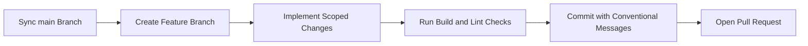

# Contributing to CivicPulse

Thank you for contributing to CivicPulse. This document outlines the local development workflow, code quality standards, verification steps, and pull request expectations.

---

## Repository Layout

- `backend/` -- Express 5, TypeScript, Mongoose 9, JWT cookie authentication, and REST controllers
- `frontend/` -- React 19, TypeScript, Vite 7, Redux Toolkit, React Router DOM 7, Axios, and Tailwind CSS 4

---

## Prerequisites

- Node.js 20+
- npm 9+
- MongoDB 6+ (local instance, container, or MongoDB Atlas)
- Git

---

## Local Development Setup

### 1. Backend

```bash
cd backend
cp .env.example .env
npm install
npm run dev
```

Update `backend/.env` with your local MongoDB URI and a development `JWT_SECRET`:

```env
MONGODB_URI=mongodb://127.0.0.1:27017/civicpulse
BACKEND_PORT=4000
JWT_SECRET=replace-with-a-long-random-secret
NODE_ENV=development
CORS_ORIGINS=http://localhost:5173,http://localhost:5174
```

Verify the API:

```bash
curl http://localhost:4000/api/health
```

### 2. Frontend

```bash
cd frontend
npm install
npm run dev
```

`frontend/.env.development` defaults to `VITE_API_BASE_URL=/api`, which Vite proxies to `http://localhost:4000`. Open `http://localhost:5173` in your browser.

---

## Contribution Workflow



1. Create a focused branch from `main`:

```bash
git checkout -b feat/short-description
```

Preferred branch prefixes: `feat/`, `fix/`, `docs/`, `refactor/`, `style/`, `chore/`.

2. Follow **Conventional Commits** (`feat:`, `fix:`, `style:`, `refactor:`, `docs:`, `chore:`) with clear, imperative commit subjects.

3. Keep changes scoped to a single concern and avoid mixing unrelated formatting changes with functional edits.

---

## Engineering Standards

- **TypeScript**: Maintain clean types across both backend and frontend; avoid introducing untyped `any` where domain types exist (`frontend/src/types/`).
- **API Access**: Use the shared Axios instance in `frontend/src/services/api.ts` rather than creating ad-hoc HTTP clients.
- **UI Discipline**: Preserve the minimal monochrome design system (`zinc` neutral palette, hairline borders, restrained semantic colors only for severity, SLA risk, and resolution states). Do not use browser `alert()` or `confirm()` dialogs.
- **Configuration**: Never hardcode secrets, credentials, or deployment hostnames in source code.

---

## Pre-PR Verification Checklist

Run all checks locally before opening a pull request:

```bash
npm --prefix backend run build
npm --prefix frontend run lint
npm --prefix frontend run build
```

Verify manually against a running backend and MongoDB instance:

- Login, Signup, Logout, and browser reload session persistence (`/api/auth/me`)
- Role-based route guards (`resident`, `staff`, `admin`)
- Issue creation, filtering, workflow transitions, staff assignment, and audit timeline rendering

---

## Pull Request Guidelines

Include the following in your pull request description:

- Summary of what changed and why
- Verification steps and test results
- Screenshots or recordings for UI updates
- Any new environment variables or deployment considerations

---

## Security Policy

- Never commit `.env` files, database credentials, API keys, or JWT secrets.
- Rotate any accidentally exposed secret immediately.
- Report security vulnerabilities privately to the repository maintainers rather than opening a public issue.
