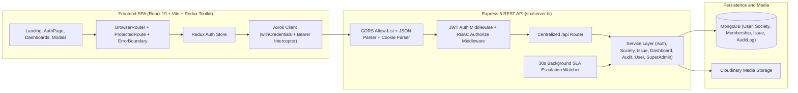
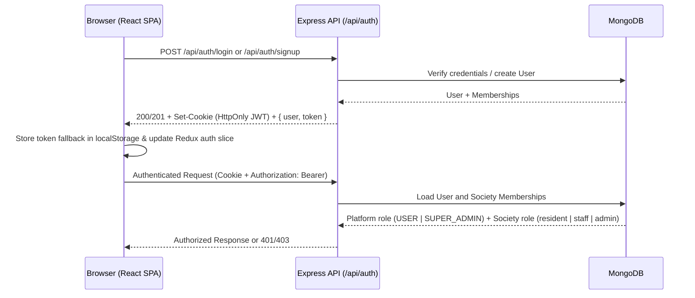
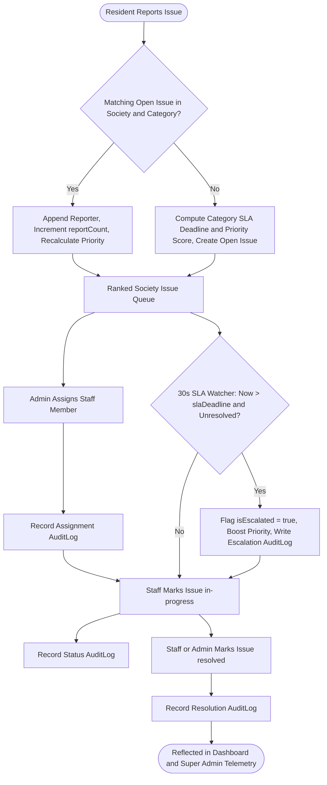
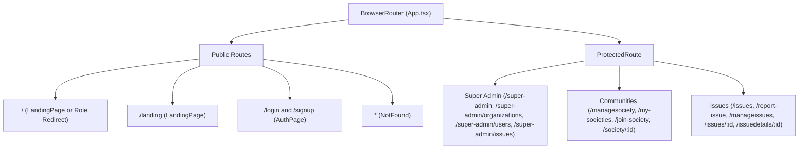
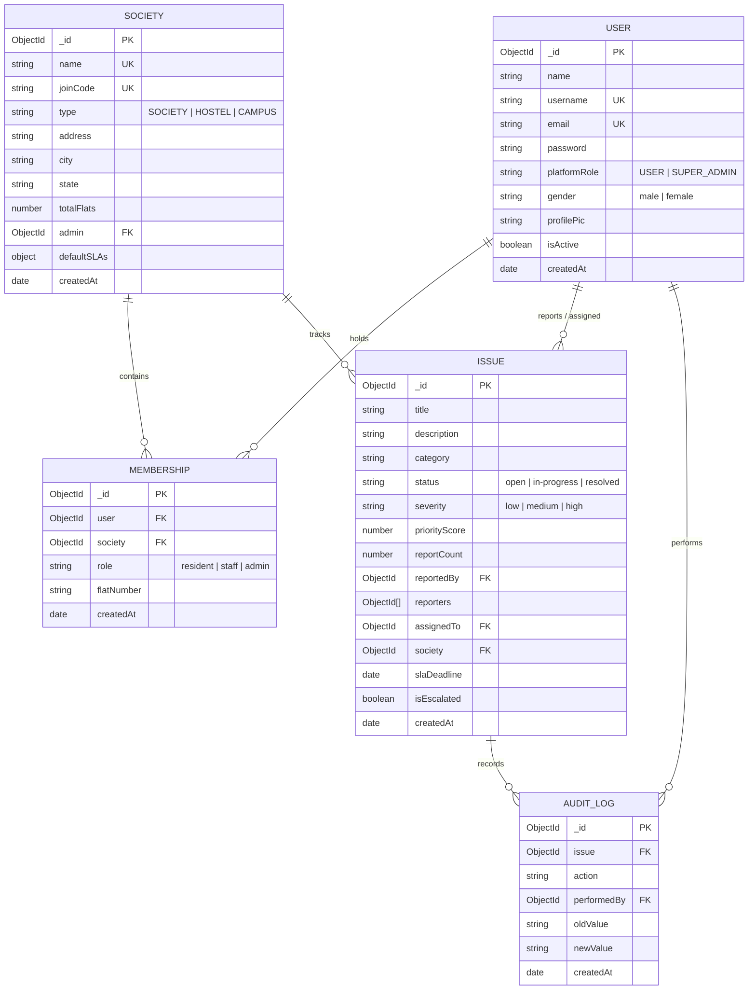

# CivicPulse

**Multi-organization civic and community issue resolution, automated SLA governance, and role-based operations platform for housing societies, student hostels, and university campuses.**

CivicPulse provides residents, students, maintenance staff, society administrators, and platform Super Admins with a unified workflow to report issues, deduplicate matching incidents, enforce Service Level Agreements (SLAs), manage multi-community memberships, and audit every status transition.

---

## Table of Contents

- [Overview](#overview)
- [Capability Matrix](#capability-matrix)
- [Technology Stack](#technology-stack)
- [System Architecture](#system-architecture)
- [Authentication and Dual-Layer RBAC Flow](#authentication-and-dual-layer-rbac-flow)
- [Issue Lifecycle and Automated SLA Escalation Flow](#issue-lifecycle-and-automated-sla-escalation-flow)
- [Frontend Routing Map](#frontend-routing-map)
- [Data Model](#data-model)
- [Project Structure](#project-structure)
- [API Reference](#api-reference)
- [Getting Started](#getting-started)
- [Environment Configuration](#environment-configuration)
- [Deployment](#deployment)
- [Phased Engineering Roadmap](#phased-engineering-roadmap)
- [Contributing](#contributing)

---

## Overview

CivicPulse replaces fragmented chat groups and spreadsheets with structured, auditable issue governance:

- **Multi-Category Organizations**: Supports Housing Societies, Student Hostels, and University Campuses under a unified community and membership model.
- **Dual-Layer RBAC**: Combines platform-level roles (`USER`, `SUPER_ADMIN`) with society-scoped memberships (`resident`, `staff`, `admin`) via `Membership` records and a live `SocietySwitcher`.
- **Automated Deduplication and SLA Escalation**: Matching open issues merge automatically to boost priority scores, and a 30-second background SLA watcher escalates overdue unresolved tickets with audit entries.
- **Profile Management and Avatars**: Built-in `UserProfileModal`, gender-aware avatar defaults, and Cloudinary image support.
- **Cross-Domain Auth Resilience**: Supports `HttpOnly` JWT cookies with automatic `Authorization: Bearer` header fallback for cross-domain deployments (Render and Vercel).

---

## Capability Matrix

Features engineered for society-scale and municipal dispatch standards, distinguishing live capabilities from upcoming roadmap milestones.

| Capability | Description | Status |
| --- | --- | --- |
| **Government and Admin Dashboard** | Role-restricted portals displaying resource allocations, SLA telemetry, Super Admin oversight, and staff/officer assignees. | Available |
| **Multi-Community Governance** | Support for Housing Societies, Student Hostels, and University Campuses with join codes, membership switching, and resident directories. | Available |
| **Automated SLA and Audit Engine** | Dynamic priority scoring, duplicate merging, periodic 30-second SLA breach escalation, and immutable activity timelines. | Available |
| **Real-Time Issue Tracking** | Live WebSocket and collection streams keeping status transitions synchronized across connected clients. | In Progress |
| **Smart Issue Reporting** | GPS coordinate pins, field imagery uploads, and speech-to-text voice reporting. | Planned |
| **AI Civic Intelligence** | Dedicated Gemini models triaging taxonomy, parsing semantic duplicates, and estimating resolution windows. | Planned |
| **Community Engagement** | Public discussions, community verifications, and neighborhood confirmation workflows. | Planned |
| **Geospatial Analytics** | Dynamic telemetry indicators outlining city categories, hot-zone density, and dispatch loads. | Planned |
| **Digital Twin Mapping** | Obsidian-styled interactive map centerpiece integrating heatmaps and emergency response layers. | Planned |
| **Leaderboard and Reputation** | Citizen identity scoring tracking levels, verified checks, and community guardian statuses. | Planned |

---

## Technology Stack

| Layer | Technologies |
| --- | --- |
| **Frontend** | React 19, TypeScript 5.9, Vite 7, Tailwind CSS 4, React Router DOM 7, Redux Toolkit 2, Axios, Lucide React, React Hot Toast |
| **Backend** | Node.js 20+, Express 5, TypeScript 5.9 (`tsconfig-paths` + `tsc-alias`), Cookie Parser, CORS, Cloudinary |
| **Database** | MongoDB 7+, Mongoose 9 |
| **Authentication** | JWT (HS256) in `HttpOnly` cookies + `Bearer` token fallback, `bcryptjs` password hashing |
| **Deployment and Tooling** | ESLint 9, Prettier, Vercel SPA rewrites, Render deployment, Docker multi-stage build |

---

## System Architecture



---

## Authentication and Dual-Layer RBAC Flow



---

## Issue Lifecycle and Automated SLA Escalation Flow



---

## Frontend Routing Map



---

## Data Model



---

## Project Structure

```text
CivicPulse/
├── backend/
│   ├── src/
│   │   ├── server.ts               # Express bootstrap, CORS, /api/health, 30s SLA escalation loop
│   │   ├── config/                 # db.ts, env.ts
│   │   ├── controllers/            # auth, audit, dashboard, issue, society, superadmin, user
│   │   ├── services/               # Business logic layer for each domain module
│   │   ├── middlewares/            # auth.middleware.ts, authorize.middleware.ts
│   │   ├── models/                 # User, Society, Membership, Issue, AuditLog
│   │   ├── routes/                 # Centralized index.ts and domain routers
│   │   ├── types/                  # express.d.ts
│   │   └── utils/                  # codeGenerator, constants, priority, responseHandler
│   ├── Dockerfile
│   └── tsconfig.json
├── frontend/
│   ├── src/
│   │   ├── App.tsx                 # BrowserRouter, Toaster, ProtectedRoute, NotFound
│   │   ├── main.tsx                # Redux Provider and ErrorBoundary
│   │   ├── app/store.ts            # Redux Toolkit store
│   │   ├── components/
│   │   │   ├── common/             # UserAvatar
│   │   │   ├── layout/             # DashboardLayout, Navbar, Sidebar, ProtectedRoute
│   │   │   ├── profile/            # UserProfileModal
│   │   │   ├── ui/                 # Badge, Card, ConfirmModal, CustomSelect, Icon, TimeLineItem
│   │   │   └── ErrorBoundary.tsx
│   │   ├── features/               # auth, dashboard, issues, society components & slices
│   │   ├── pages/
│   │   │   ├── admin/              # SuperAdminDashboard + detail modals
│   │   │   ├── auth/               # AuthPage (Sign In / Create Account)
│   │   │   ├── dashboard/          # Dashboard, AdminDashboard, MemberDashboard, ResidentDashboard
│   │   │   ├── issues/             # IssueList, ReportIssue, ManageIssues, IssueDetails, IssueAssign
│   │   │   ├── landing/            # LandingPage (Hero, Categories, Roles, Capability Matrix, Roadmap)
│   │   │   ├── society/            # ManageSociety, JoinSociety, SocietyIssues
│   │   │   └── NotFound.tsx
│   │   ├── services/api.ts         # Axios client with credentials and Bearer interceptor
│   │   └── types/                  # Shared domain TypeScript interfaces
│   ├── vercel.json
│   └── vite.config.ts
├── CONTRIBUTING.md
└── README.md
```

---

## API Reference

Base URL: `/api` (proxied to `http://localhost:4000/api` in local development).

### Health and Diagnostics

| Method | Endpoint | Access | Description |
| --- | --- | --- | --- |
| `GET` | `/api/health` | Public | Returns service health and uptime |
| `GET` | `/api/test` | Public | Basic connectivity check |

### Authentication and Profile

| Method | Endpoint | Access | Description |
| --- | --- | --- | --- |
| `POST` | `/api/auth/signup` | Public | Register a new account with username, gender, and optional avatar |
| `POST` | `/api/auth/login` | Public | Authenticate and receive `HttpOnly` cookie and JWT token |
| `POST` | `/api/auth/logout` | Public | Clear session cookie |
| `GET` | `/api/auth/me` | Authenticated | Return current user and memberships |
| `PATCH` | `/api/users/profile` | Authenticated | Update user profile fields and avatar |

### Societies and Memberships

| Method | Endpoint | Access | Description |
| --- | --- | --- | --- |
| `POST` | `/api/society/create` | Super Admin | Create a new Society, Hostel, or Campus |
| `POST` | `/api/society/join` | Authenticated | Join an existing community using a join code |
| `POST` | `/api/society/current` | Authenticated | Switch active society context |
| `GET` | `/api/society/current` | Authenticated | Get active society details |
| `GET` | `/api/society/my-joined-societies` | Authenticated | List all communities joined by the current user |
| `GET` | `/api/society/my-admin-organizations` | Admin | List organizations administered by the current user |
| `GET` | `/api/society/residents` | Member / Staff / Admin | List members of the active society |
| `GET` | `/api/society/:id` | Authenticated | Get community metadata by ID |
| `GET` | `/api/society/:id/issues` | Authenticated | List issues within a specific community |

### Issues, Dashboard, and Audit

| Method | Endpoint | Access | Description |
| --- | --- | --- | --- |
| `GET` | `/api/issues` | Authenticated | List issues for the active community or role |
| `POST` | `/api/issues` | Resident | Report an issue or merge into an open duplicate |
| `GET` | `/api/issues/:id` | Authenticated | Fetch issue detail, SLA status, and metadata |
| `PATCH` | `/api/issues/:id` | Staff, Admin | Update issue workflow status |
| `PATCH` | `/api/issues/:id/assign` | Admin | Assign maintenance staff to an issue |
| `GET` | `/api/issues/:id/logs` | Staff, Admin | Retrieve chronological audit logs for an issue |
| `GET` | `/api/dashboard` | Admin | Aggregated KPI metrics and category stats |
| `GET` | `/api/super-admin/*` | Super Admin | Platform-wide organizations, users, and issues command center |

---

## Getting Started

### Prerequisites

- Node.js 20+
- npm 9+
- MongoDB 6+ (local instance, Docker/Podman container, or MongoDB Atlas)

```bash
docker run -d --name civicpulse-mongo -p 27017:27017 mongo:7
```

### 1. Backend Setup

```bash
cd backend
cp .env.example .env
npm install
npm run dev
```

Verify the backend:

```bash
curl http://localhost:4000/api/health
```

### 2. Frontend Setup

```bash
cd frontend
npm install
npm run dev
```

Open `http://localhost:5173`. Vite proxies `/api` requests directly to `http://localhost:4000`.

---

## Environment Configuration

### Backend (`backend/.env`)

| Variable | Required | Default | Description |
| --- | --- | --- | --- |
| `MONGODB_URI` | Yes | -- | MongoDB connection URI (use `127.0.0.1` for local Docker/Podman containers) |
| `JWT_SECRET` | Yes | `default_jwt_secret` | Signing secret for JWT authentication tokens |
| `PORT` / `BACKEND_PORT` | No | `4000` | HTTP server port |
| `FRONTEND_URL` | No | `http://localhost:5173` | Primary allowed frontend origin |
| `CORS_ORIGINS` | No | Localhost defaults | Optional comma-separated additional CORS origins |

### Frontend (`frontend/.env.development`)

| Variable | Default | Description |
| --- | --- | --- |
| `VITE_API_URL` | `/api` | Base URL for Axios requests (use `/api` locally for Vite proxy; full API URL in production) |
| `VITE_PROXY_TARGET` | `http://localhost:4000` | Target backend URL for the Vite dev proxy |

---

## Deployment

- **Frontend (Vercel)**: Root directory `frontend`, build command `npm run build`, output `dist`. `frontend/vercel.json` handles SPA rewrites. Set `VITE_API_URL=https://<backend-domain>/api`.
- **Backend (Render / Docker)**: Build with `npm run build` (`tsc && tsc-alias`), start with `npm start` (`node dist/server.js`), or deploy with `backend/Dockerfile`. Set `MONGODB_URI`, `JWT_SECRET`, and `FRONTEND_URL`.

---

## Phased Engineering Roadmap

| Phase | Scope | Deliverables |
| --- | --- | --- |
| **Phase 01 (Live)** | Multi-Community Governance and SLA Engine | Societies/Hostels/Campuses, Super Admin command center, multi-society memberships, automated 30-second SLA escalation, profile/avatar modals, audit logs. |
| **Phase 02 (Next Up)** | AI Triage, Rich Media, and Live Streams | Gemini AI Civic Intelligence for taxonomy and ETA estimation; GPS coordinate pins, imagery uploads, voice-to-text reporting; WebSocket live updates. |
| **Phase 03 (Future Vision)** | Digital Twin and Citizen Ecosystem | Obsidian-styled interactive map with heatmaps and emergency layers; geospatial telemetry dashboards; public discussions, citizen verification, and reputation leaderboards. |

---

## Contributing

See [CONTRIBUTING.md](CONTRIBUTING.md) for development workflow, code standards, verification commands, and pull request guidelines.
