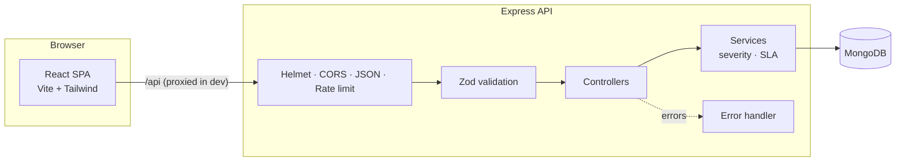

# CivicPulse

**Priority-aware issue reporting and resolution for campuses, hostels, and residential communities.**

CivicPulse gives residents a single place to report problems such as broken lights, water leaks, or unsafe wiring, and gives maintainers a ranked queue to work from. Every issue gets an automatic **severity score** and a **response deadline (SLA)**, so the most urgent problems rise to the top and nothing quietly goes stale.

---

## Table of contents

- [Features](#features)
- [Tech stack](#tech-stack)
- [Architecture](#architecture)
- [Project structure](#project-structure)
- [Getting started](#getting-started)
- [Configuration](#configuration)
- [Available scripts](#available-scripts)
- [API reference](#api-reference)
- [Severity and SLA model](#severity-and-sla-model)
- [Data model](#data-model)
- [Frontend design system](#frontend-design-system)
- [Deployment](#deployment)
- [Security notes and known limitations](#security-notes-and-known-limitations)
- [Roadmap](#roadmap)
- [Contributing](#contributing)

---

## Features

| Area | What it does |
| --- | --- |
| **Issue reporting** | A guided form with inline validation, character counters, and an impact selector ("Just me", "A group", "Everyone"). Reporters can stay anonymous. |
| **Automatic triage** | Each issue gets a 0–100 severity score from its category, impact, and community upvotes. The score sets its priority: Critical, High, Medium, or Low. |
| **SLA tracking** | Each priority has a response deadline. The UI shows a live countdown and marks overdue issues. |
| **Issue queue** | Search, filter (status, category, priority), sort (severity, newest, upvotes, due date) and paginate. Filters are stored in the URL, so views can be bookmarked and shared. |
| **Community upvotes** | Upvotes raise an issue's severity and can tighten its deadline. Each browser can upvote an issue once. |
| **Status workflow** | `open → in_progress → resolved / closed`, with the resolution time recorded. |
| **Overview stats** | Counts of open, in-progress, and resolved issues, plus the number past their SLA. |
| **Health monitoring** | `/api/health` reports API and database status. The footer shows live system status. |

## Tech stack

| Layer | Technology |
| --- | --- |
| Frontend | React 19, TypeScript, Vite 7, Tailwind CSS 4, React Router |
| Backend | Node.js 20+, Express 5, TypeScript (strict) |
| Database | MongoDB 6+ with Mongoose 9 |
| Validation | Zod (request schemas), Mongoose schema validation |
| Security | Helmet, CORS allow-list, JSON body size limit, per-IP rate limiting on writes |
| Tooling | ESLint, Prettier, Docker (multi-stage build) |

## Architecture



The backend is split into **feature modules**. Each module has `routes → controller → service → model`:

- **Routes** declare the endpoints and attach validation and rate-limiting middleware.
- **Controllers** stay thin. They read validated input from `res.locals` and shape the HTTP response.
- **Services** hold the business logic (queries, severity scoring, SLA rules).
- **Models** define the Mongoose schema, indexes, and JSON serialisation.

Express 5 forwards errors from `async` handlers to the central error middleware automatically. That middleware turns Zod, Mongoose, and JSON-parse errors into one consistent error format.

## Project structure

```
CivicPulse/
├── backend/
│   ├── src/
│   │   ├── app.ts                    # Express app: security, parsers, routes, error handling
│   │   ├── server.ts                 # Bootstrap: DB connect, listen, graceful shutdown
│   │   ├── routes.ts                 # /api router (health + module routers)
│   │   ├── config/
│   │   │   ├── env.ts                # Typed, validated environment config
│   │   │   └── db.ts                 # MongoDB connection lifecycle and status
│   │   ├── middlewares/
│   │   │   ├── error.middleware.ts   # HttpError, 404 handler, central error handler
│   │   │   ├── validate.middleware.ts# Zod request validation
│   │   │   └── rateLimit.middleware.ts
│   │   ├── modules/
│   │   │   └── issues/
│   │   │       ├── issues.routes.ts
│   │   │       ├── issues.controller.ts
│   │   │       ├── issues.service.ts
│   │   │       ├── issues.model.ts
│   │   │       ├── issues.validation.ts
│   │   │       ├── issues.types.ts
│   │   │       └── severity.service.ts
│   │   └── utils/                    # logger, shared validators
│   ├── Dockerfile
│   └── .env.example
├── frontend/
│   ├── src/
│   │   ├── components/               # Layout, IssueCard, IssueList, SLAClock, filters…
│   │   │   └── ui/                   # Button, Field, Badge, Icon, feedback states
│   │   ├── features/issues/          # Types and API bindings for issues
│   │   ├── hooks/                    # useQuery (data fetching), useNow
│   │   ├── pages/                    # Home, ReportIssue, IssueDetail, NotFound
│   │   ├── routes/                   # Router configuration
│   │   ├── services/apiClient.ts     # Typed fetch wrapper with ApiError
│   │   └── utils/                    # constants, formatters, severity styles, validators
│   ├── vite.config.ts                # Dev proxy for /api
│   └── .env.example
├── CONTRIBUTING.md
└── README.md
```

> Files such as `auth.*`, `comments.*`, `reports.*`, `sockets/*`, `config/redis.ts`, and the Redux placeholders in `frontend/src/app` are **scaffolding for planned modules** (see [Roadmap](#roadmap)). They are not wired into the app yet.

## Getting started

### Prerequisites

- **Node.js** 20 or newer (`node -v`)
- **npm** 9 or newer
- **MongoDB** 6 or newer, installed locally or run in Docker:

```bash
docker run -d --name civicpulse-mongo -p 27017:27017 mongo:7
```

### 1. Clone

```bash
git clone https://github.com/codxbrexx/CivicPulse.git
cd CivicPulse
```

### 2. Start the API

```bash
cd backend
cp .env.example .env        # adjust values if needed
npm install
npm run dev                 # http://localhost:4000
```

Check that it's up:

```bash
curl http://localhost:4000/api/health
# {"status":"ok","uptime":3,"database":"connected","timestamp":"..."}
```

### 3. Start the web app

In a second terminal:

```bash
cd frontend
npm install
npm run dev                 # http://localhost:5173
```

The Vite dev server proxies `/api/*` to `http://localhost:4000`, so no CORS setup is needed during development.

## Configuration

### Backend: `backend/.env`

The API loads `backend/.env` first, then a root-level `.env` as a fallback. Variables already set in the shell take precedence. Every value is validated at startup. Invalid configuration stops the process with a clear message.

| Variable | Default | Description |
| --- | --- | --- |
| `NODE_ENV` | `development` | `development`, `test`, or `production`. In production, stack traces are hidden from error responses. |
| `PORT` | `4000` | HTTP port. `BACKEND_PORT` is also accepted for backwards compatibility. |
| `MONGODB_URI` | `mongodb://localhost:27017/civicpulse` | MongoDB connection string. `MONGO_URI` is also accepted. |
| `CORS_ORIGIN` | `http://localhost:5173` | Comma-separated list of allowed browser origins. |
| `LOG_LEVEL` | `info` | `debug`, `info`, `warn`, or `error`. `debug` logs every request with its timing. |

### Frontend: `frontend/.env`

| Variable | Default | Description |
| --- | --- | --- |
| `VITE_API_URL` | `/api` | Base URL of the API. Keep `/api` in development to use the proxy. Set a full URL (e.g. `https://api.example.com/api`) when the API is on another origin. |
| `VITE_PROXY_TARGET` | `http://localhost:4000` | *(dev server only)* Where the `/api` proxy forwards requests. |

## Available scripts

### Backend (`backend/`)

| Command | Description |
| --- | --- |
| `npm run dev` | Start the API with hot reload (ts-node-dev) |
| `npm run build` | Compile TypeScript to `dist/` |
| `npm start` | Run the compiled server (`dist/server.js`) |
| `npm run typecheck` | Type-check without emitting files |
| `npm run format` | Format sources with Prettier |

### Frontend (`frontend/`)

| Command | Description |
| --- | --- |
| `npm run dev` | Start the Vite dev server |
| `npm run build` | Type-check and build for production into `dist/` |
| `npm run preview` | Serve the production build locally |
| `npm run lint` | Run ESLint |

## API reference

Base URL: `http://localhost:4000/api`

All responses are JSON. Successful responses wrap their payload in `data`. Errors use one consistent format:

```json
{
  "error": {
    "message": "Validation failed",
    "details": [{ "field": "title", "message": "Title must be at least 5 characters" }]
  }
}
```

| Status | Meaning |
| --- | --- |
| `400` | Invalid input: validation failure, malformed JSON, or invalid ID |
| `404` | Resource or route not found |
| `413` | Request body larger than 100 KB |
| `429` | Rate limit exceeded (30 writes per minute per IP). See the `Retry-After` header. |
| `500` | Unexpected server error |
| `503` | Health check: the database is unavailable |

### Endpoints

| Method | Path | Description |
| --- | --- | --- |
| `GET` | `/health` | API and database health |
| `GET` | `/issues` | List issues (filter, search, sort, paginate) |
| `GET` | `/issues/stats` | Counts by status and number of overdue issues |
| `GET` | `/issues/:id` | Get a single issue |
| `POST` | `/issues` | Report a new issue |
| `POST` | `/issues/:id/upvote` | Upvote an issue (recalculates severity) |
| `PATCH` | `/issues/:id/status` | Change an issue's status |

#### `GET /issues`

| Query param | Type | Default | Notes |
| --- | --- | --- | --- |
| `status` | `open` \| `in_progress` \| `resolved` \| `closed` | — | |
| `category` | `safety` \| `electricity` \| `water` \| `sanitation` \| `infrastructure` \| `internet` \| `other` | — | |
| `priority` | `critical` \| `high` \| `medium` \| `low` | — | |
| `q` | string (≤ 100 chars) | — | Case-insensitive search across title, description, and location |
| `sort` | `severity` \| `newest` \| `upvotes` \| `due` | `severity` | |
| `page` | integer ≥ 1 | `1` | |
| `limit` | integer 1–100 | `20` | |

```bash
curl "http://localhost:4000/api/issues?status=open&sort=due&limit=5"
```

```json
{
  "data": [ { "id": "6afc…", "title": "Exposed wiring near staircase", "severity": 76, "priority": "critical", "...": "..." } ],
  "meta": { "page": 1, "limit": 5, "total": 12, "totalPages": 3 }
}
```

#### `POST /issues`

| Field | Type | Rules |
| --- | --- | --- |
| `title` | string | 5–120 characters, required |
| `description` | string | 10–2000 characters, required |
| `category` | enum | required (see categories above) |
| `location` | string | 2–120 characters, required |
| `impact` | `individual` \| `group` \| `community` | default `individual` |
| `reporterName` | string | ≤ 60 characters, optional |

```bash
curl -X POST http://localhost:4000/api/issues \
  -H "Content-Type: application/json" \
  -d '{
        "title": "Exposed wiring near staircase",
        "description": "Live wires hanging from the ceiling on floor 2 of Hostel B.",
        "category": "safety",
        "impact": "community",
        "location": "Hostel B, Floor 2"
      }'
```

Returns `201 Created` with a `Location` header and the created issue. Severity, priority, and SLA are calculated by the server and cannot be set by the client.

#### `PATCH /issues/:id/status`

```bash
curl -X PATCH http://localhost:4000/api/issues/<id>/status \
  -H "Content-Type: application/json" \
  -d '{ "status": "resolved" }'
```

Setting `resolved` or `closed` records `resolvedAt`. Re-opening the issue clears it.

#### `GET /issues/stats`

```json
{ "data": { "total": 12, "open": 6, "in_progress": 3, "resolved": 2, "closed": 1, "overdue": 1 } }
```

## Severity and SLA model

Severity is a transparent, deterministic score from **0 to 100**, implemented in [`severity.service.ts`](backend/src/modules/issues/severity.service.ts):

```
severity = category weight + impact weight + vote score    (capped at 100)
```

| Category | Weight | | Impact | Weight |
| --- | --- | --- | --- | --- |
| Safety | 40 | | Individual | 0 |
| Electricity | 30 | | Group | 15 |
| Water | 30 | | Community | 30 |
| Sanitation | 25 | | | |
| Infrastructure | 20 | | | |
| Internet | 15 | | | |
| Other | 10 | | | |

**Vote score** is `min(30, round(log2(upvotes + 1) × 6))`. Because it's logarithmic, the first few upvotes count the most and no issue can climb on votes alone.

| Severity | Priority | Response target (SLA) |
| --- | --- | --- |
| 70 – 100 | Critical | 4 hours |
| 50 – 69 | High | 24 hours |
| 30 – 49 | Medium | 3 days |
| 0 – 29 | Low | 7 days |

The SLA deadline is measured from when the issue was created. When upvotes push an issue into a higher priority, the deadline **only ever tightens**. It is never extended.

## Data model

`Issue` collection:

| Field | Type | Notes |
| --- | --- | --- |
| `title` | string | trimmed, 5–120 |
| `description` | string | trimmed, 10–2000 |
| `category` | enum | see above |
| `impact` | enum | `individual`, `group`, `community` |
| `location` | string | free text, e.g. "Hostel B, Floor 2" |
| `reporterName` | string? | optional |
| `status` | enum | default `open` |
| `upvotes` | number | ≥ 0, incremented atomically |
| `severity` | number | 0–100, server-computed |
| `priority` | enum | derived from severity |
| `slaDueAt` | Date | deadline for a response |
| `resolvedAt` | Date? | set when resolved or closed |
| `createdAt` / `updatedAt` | Date | Mongoose timestamps |

Indexes: `{status, severity}`, `{category, status}`, `{createdAt}`. In API responses, `_id` is exposed as `id` and `__v` is removed.

## Frontend design system

The interface aims to be calm, minimal, and readable:

- **Neutral palette.** Zinc greys on an off-white background. Near-black (`zinc-900`) is the only accent for primary actions.
- **No gradients or decoration.** Flat surfaces, 1px borders, and very light shadows.
- **Colour carries meaning.** Colour is used only for status and priority: red = critical, orange = high, amber = medium, grey = low. Blue, violet, green, and grey mark the statuses.
- **Typography.** Inter with tabular numbers for counts and timers, and a tight heading scale.
- **Every state is designed.** Loading skeletons, empty states (with and without filters), inline error states with retry, and success confirmations.
- **Accessibility.** Semantic landmarks, a skip link, labelled controls, `aria-invalid` and error descriptions on form fields, visible focus rings, and focus moves to the first invalid field on submit.
- **Responsive.** Single-column layouts on phones. Filters reflow into a two-column grid.

Shared building blocks are in [`frontend/src/components/ui`](frontend/src/components/ui): `Button`, `ButtonLink`, `Field`, `TextInput`, `TextArea`, `Select`, `StatusBadge`, `PriorityBadge`, `Card`, `Alert`, `EmptyState`, `ErrorState`, `Skeleton`, `Icon`.

## Deployment

### API with Docker

The backend image is a multi-stage build. TypeScript is compiled in a build stage, and the runtime image contains only production dependencies and `dist/`. It runs as a non-root user and includes a health check.

```bash
cd backend
docker build -t civicpulse-api .
docker run -d -p 4000:4000 \
  -e MONGODB_URI="mongodb://host.docker.internal:27017/civicpulse" \
  -e CORS_ORIGIN="https://your-frontend.example.com" \
  civicpulse-api
```

### Frontend

```bash
cd frontend
VITE_API_URL=https://api.example.com/api npm run build
```

Serve `frontend/dist/` from any static host (Nginx, Netlify, Vercel, S3 + CloudFront). Configure the host to fall back to `index.html` so client-side routes like `/issues/:id` work on refresh.

## Security notes and known limitations

- **No authentication yet.** Anyone with network access can change an issue's status. Put the API behind an authenticated gateway, or finish the planned auth module, before exposing it publicly.
- **Upvote de-duplication is per browser.** It uses `localStorage`. The server-side rate limit reduces abuse but does not prevent it. Per-user votes come with authentication.
- **The rate limiter is in-memory.** It is correct for a single instance. Use a Redis-backed store when running several replicas.
- `trust proxy` is set to `1` so client IPs are read correctly behind one reverse proxy. Change this if your setup is different.

## Roadmap

- [ ] Authentication and roles (resident, maintainer, admin) with JWT
- [ ] Maintainer and admin dashboards, assignment of issues to staff
- [ ] Duplicate detection and clustering of similar reports
- [ ] Real-time updates over WebSockets
- [ ] Comments and activity timeline per issue
- [ ] Analytics: resolution times, SLA compliance, hotspots
- [ ] Map view for location-based browsing
- [ ] Redis for rate limiting, caching, and background jobs (SLA breach notifications)
- [ ] Automated test suites (API integration tests, component tests)

## Contributing

Contributions are welcome. See [CONTRIBUTING.md](CONTRIBUTING.md) for the development workflow, coding standards, and commit conventions.
