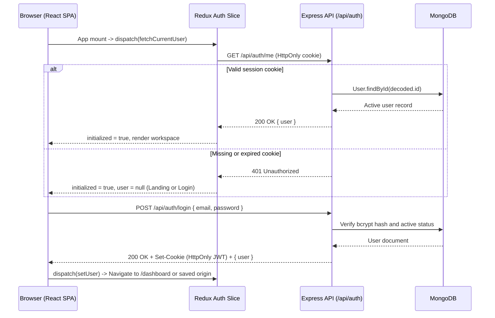
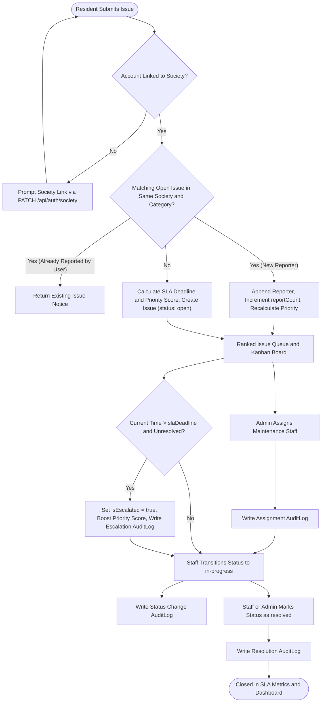
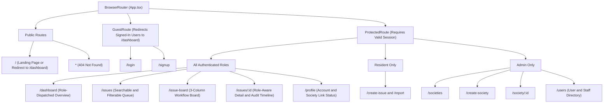
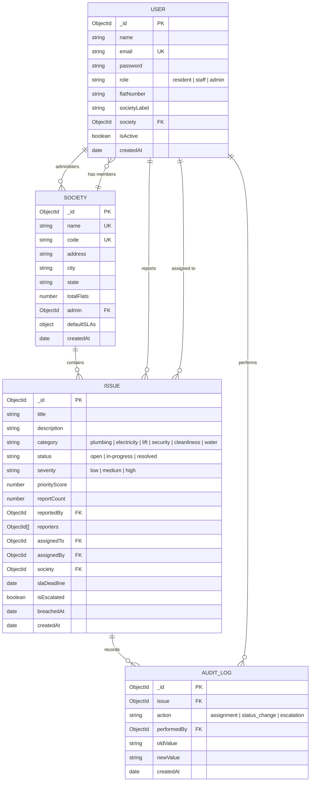

# CivicPulse

**Priority-aware civic and residential society issue resolution, SLA tracking, and role-based operations platform.**

CivicPulse provides residential societies, campuses, and municipal communities with a unified system to report maintenance problems, merge duplicate reports automatically, enforce Service Level Agreement (SLA) deadlines, assign staff, and maintain a complete audit trail across every status transition.

---

## Table of Contents

- [Overview](#overview)
- [Capability Matrix](#capability-matrix)
- [Technology Stack](#technology-stack)
- [System Architecture](#system-architecture)
- [Authentication and Session Flow](#authentication-and-session-flow)
- [Issue Lifecycle and SLA Escalation Flow](#issue-lifecycle-and-sla-escalation-flow)
- [Role-Based Access Control and Routing](#role-based-access-control-and-routing)
- [Data Model](#data-model)
- [Project Structure](#project-structure)
- [Getting Started](#getting-started)
- [Demo Accounts (Local Development)](#demo-accounts-local-development)
- [Environment Configuration](#environment-configuration)
- [API Reference](#api-reference)
- [Priority Scoring and SLA Model](#priority-scoring-and-sla-model)
- [Deployment](#deployment)
- [Security Controls](#security-controls)
- [Phased Engineering Roadmap](#phased-engineering-roadmap)
- [Contributing](#contributing)

---

## Overview

Community maintenance commonly fails in two ways: urgent safety hazards get buried behind minor requests, and open tickets silently stall without ownership or deadlines. CivicPulse resolves both through:

- **Role-Based Workspaces**: Dedicated views and permissions for Residents, Maintenance Staff, and Administrators.
- **Automatic Deduplication and Priority Scoring**: Matching open reports in the same society and category merge into one issue, incrementing the report counter and raising the priority score.
- **Category-Driven SLA Enforcement**: Every issue receives a deadline based on its category and society SLA configuration; overdue unresolved issues escalate automatically and log an escalation event.
- **Immutable Audit Trail**: Assignments, status transitions, and SLA breaches are recorded in MongoDB and rendered in a chronological activity timeline.
- **Minimal, High-Signal Interface**: Restrained monochrome design system reserving semantic color strictly for severity, SLA risk, and resolution state.

---

## Capability Matrix

Features engineered for society-scale and municipal dispatch standards, distinguishing live production capabilities from upcoming roadmap milestones.

| Capability | Description | Status |
| --- | --- | --- |
| **Government and Admin Dashboard** | Role-restricted portals displaying issue metrics, SLA breach counts, category breakdowns, society directory, and staff assignees. | Available |
| **Role-Based Issue Workflow** | Resident issue submission, Kanban workflow board (`open`, `in-progress`, `resolved`), staff assignment, and full audit timeline. | Available |
| **Automatic Priority and SLA Engine** | Duplicate report merging, weighted category priority scoring, live countdown timers, and automatic SLA breach escalation. | Available |
| **Real-Time Issue Tracking** | WebSocket and collection streams keeping status transitions and escalations synchronized live across connected clients. | In Progress |
| **Smart Issue Reporting** | GPS coordinate pins, field imagery uploads, and speech-to-text voice reporting. | Planned |
| **AI Civic Intelligence** | Dedicated Gemini models triaging taxonomy, parsing semantic duplicates, and estimating resolution windows. | Planned |
| **Community Engagement** | Public issue discussions, neighborhood verifications, and community confirmation workflows. | Planned |
| **Geospatial Analytics** | Dynamic telemetry indicators outlining ward-level categories, hot-zone density, and dispatch loads. | Planned |
| **Digital Twin Mapping** | Obsidian-styled interactive map centerpiece integrating incident heatmaps and emergency response layers. | Planned |
| **Leaderboard and Reputation** | Citizen identity scoring tracking trust tiers, verified checks, and community guardian statuses. | Planned |

---

## Technology Stack

| Layer | Technologies |
| --- | --- |
| **Frontend** | React 19, TypeScript 5.9, Vite 7, Tailwind CSS 4, React Router DOM 7, Redux Toolkit 2, Axios |
| **Backend** | Node.js 20+, Express 5, TypeScript 5.9, Cookie Parser, CORS |
| **Database** | MongoDB 7+, Mongoose 9 |
| **Authentication** | JWT (HS256) in `HttpOnly` cookies, `bcryptjs` password hashing, role-based authorization middleware |
| **Quality and Tooling** | ESLint 9, TypeScript Compiler (`tsc`), Prettier, Docker (multi-stage build), Vercel SPA/Serverless support |

---

## System Architecture

```mermaid
flowchart LR
    subgraph Client["Frontend SPA (React 19 + Vite + Redux Toolkit)"]
        UI["Minimal Monochrome UI"]
        Router["BrowserRouter + Role Guards"]
        Store["Redux Auth Store"]
        Http["Axios Client (/api, withCredentials)"]
    end

    subgraph Proxy["Dev Proxy / Edge Rewrite"]
        Edge["Vite Proxy (/api -> :4000) / Vercel"]
    end

    subgraph API["Express 5 REST API"]
        Sec["Security Headers + CORS + JSON Parser + Cookie Parser"]
        AuthMW["JWT Cookie Auth + RBAC Middleware + Rate Limiter"]
        Ctrl["Controllers (Auth, Society, Issue, Dashboard, Audit, User)"]
        Logic["Priority Calculator + SLA Escalation + Auto-Linking"]
        Err["Centralized Error and 404 Middleware"]
    end

    subgraph Data["Persistence Layer"]
        Mongo[("MongoDB 7 (Users, Societies, Issues, AuditLogs)")]
    end

    UI --> Router --> Store --> Http --> Edge --> Sec --> AuthMW --> Ctrl --> Logic --> Mongo
    Ctrl -. "Unhandled / Domain Errors" .-> Err
```



---

## Authentication and Session Flow

CivicPulse uses signed JSON Web Tokens stored inside `HttpOnly` cookies so session credentials are never exposed to client-side JavaScript. On every application load or browser refresh, the frontend hydrates session state before evaluating protected routes.



---

## Issue Lifecycle and SLA Escalation Flow



---

## Role-Based Access Control and Routing



### Permission Matrix

| Capability / Route | Resident | Staff | Admin |
| --- | --- | --- | --- |
| View Landing, Login, Signup | Yes | Yes | Yes |
| Access `/dashboard` and `/profile` | Yes (Resident view) | Yes (Staff view) | Yes (Admin view) |
| View society issues (`/issues`, `/issue-board`, `/issues/:id`) | Society-wide | Assigned issues | All societies |
| Report new issue (`POST /api/issues`) | Yes | No | No |
| Update issue status (`PATCH /api/issues/:id`) | No | Yes | Yes |
| View issue audit timeline (`GET /api/issues/:id/logs`) | No | Yes | Yes |
| Assign staff (`PATCH /api/issues/:id/assign`) | No | No | Yes |
| Manage societies (`GET/POST /api/society`) | No | No | Yes |
| View dashboard analytics (`GET /api/dashboard`) | No | No | Yes |
| View users directory (`GET /api/users`) | No | No | Yes |

---

## Data Model



---

## Project Structure

```text
CivicPulse/
├── backend/
│   ├── api/                        # Vercel serverless entrypoints
│   ├── src/
│   │   ├── app.ts                  # Express app, security headers, CORS, routes, error handler
│   │   ├── server.ts               # Database bootstrap, dev demo seeding, HTTP server
│   │   ├── config/
│   │   │   ├── db.ts               # Cached Mongoose connection helper
│   │   │   └── env.ts              # Environment parser, CORS origin allow-list, validation
│   │   ├── controllers/
│   │   │   ├── audit.controller.ts
│   │   │   ├── auth.controller.ts  # Signup, login, logout, /me, society linking, demo seeding
│   │   │   ├── dashboard.controller.ts
│   │   │   ├── issue.controller.ts # Deduplication, SLA escalation, status, assignment
│   │   │   ├── society.controller.ts
│   │   │   └── user.controller.ts
│   │   ├── middlewares/
│   │   │   ├── auth.middleware.ts      # JWT cookie verification
│   │   │   ├── authorize.middleware.ts # Role enforcement
│   │   │   ├── error.middleware.ts     # Centralized 404 and error formatting
│   │   │   └── rateLimit.middleware.ts # Fixed-window IP rate limiter
│   │   ├── models/                 # User, Society, Issue, AuditLog Mongoose schemas
│   │   ├── routes/                 # Modular Express routers (/auth, /society, /issues, /dashboard, /users)
│   │   ├── types/express.d.ts      # Express Request user augmentation
│   │   └── utils/priority.ts       # Priority score calculation
│   ├── Dockerfile                  # Multi-stage production container build
│   ├── .env.example
│   └── tsconfig.json
├── frontend/
│   ├── src/
│   │   ├── App.tsx                 # BrowserRouter, session hydration, route tree
│   │   ├── main.tsx                # Redux Provider and ErrorBoundary root
│   │   ├── index.css               # Tailwind CSS 4 base typography and monochrome tokens
│   │   ├── app/store.ts            # Redux Toolkit store configuration
│   │   ├── components/
│   │   │   ├── DashboardStats.tsx  # Admin KPI cards and category distribution bars
│   │   │   ├── ErrorBoundary.tsx   # Global React render error fallback
│   │   │   ├── Navbar.tsx          # Sticky topbar, quick actions, async sign out
│   │   │   ├── ProtectedRoute.tsx  # Auth guard, role guard, GuestRoute, loading screen
│   │   │   ├── SLATimer.tsx        # Live SLA deadline countdown and breach indicator
│   │   │   ├── Sidebar.tsx         # Role-filtered navigation and mobile drawer
│   │   │   ├── SocietyLinkBanner.tsx
│   │   │   └── ui/                 # Badge, Button, Card, Icon, TimeLineItem
│   │   ├── features/auth/          # authSlice (fetchCurrentUser, signOutUser, setUser)
│   │   ├── hooks/                  # useAppDispatch, useAppSelector, useAuth
│   │   ├── layouts/DashboardLayout.tsx
│   │   ├── pages/
│   │   │   ├── LandingPage.tsx     # Hero, live triage preview, Capability Matrix, Roadmap
│   │   │   ├── Profile.tsx         # User profile and society linking
│   │   │   ├── NotFound.tsx        # 404 and route error fallback
│   │   │   ├── admin/Users.tsx     # Admin user and staff directory
│   │   │   ├── auth/               # Login (with dev demo shortcuts) and Signup
│   │   │   ├── dashboard/          # Dashboard dispatcher, Admin, Resident, Staff dashboards
│   │   │   ├── issues/             # IssueList, IssueBoard, CreateIssue, IssueDetails
│   │   │   └── society/            # SocietyList, SocietyIssues, CreateSociety
│   │   ├── services/api.ts         # Credentialed Axios client with 10s timeout
│   │   └── types/                  # User, Issue, Society TypeScript interfaces
│   ├── vercel.json                 # SPA rewrite configuration
│   ├── vite.config.ts              # Vite dev server and /api proxy
│   └── .env.example
├── CONTRIBUTING.md
└── README.md
```

---

## Getting Started

### Prerequisites

- **Node.js** 20 or newer (`node -v`)
- **npm** 9 or newer (`npm -v`)
- **MongoDB** 6 or newer (local service, MongoDB Atlas, or container):

```bash
docker run -d --name civicpulse-mongo -p 27017:27017 mongo:7
# or using Podman:
podman run -d --name civicpulse-mongo -p 27017:27017 docker.io/library/mongo:7
```

### 1. Clone the Repository

```bash
git clone https://github.com/codxbrexx/CivicPulse.git
cd CivicPulse
```

### 2. Configure and Start the Backend

```bash
cd backend
cp .env.example .env
npm install
npm run dev
```

On local Linux containers (Docker/Podman), use `MONGODB_URI=mongodb://127.0.0.1:27017/civicpulse` in `backend/.env` to avoid IPv6 localhost resolution issues.

Verify the API is running:

```bash
curl http://localhost:4000/api/health
```

### 3. Configure and Start the Frontend

In a second terminal:

```bash
cd frontend
npm install
npm run dev
```

Open `http://localhost:5173` in your browser. In development, Vite automatically proxies `/api/*` requests to `http://localhost:4000`, keeping authentication cookies first-party.

---

## Demo Accounts (Local Development)

When `NODE_ENV` is not `production`, the backend automatically seeds a default society (**CivicPulse Residency**, code `CP101`) and three accounts for immediate testing (also accessible via the one-click **Quick demo access** buttons on `/login`):

| Role | Email | Password | Linked Society |
| --- | --- | --- | --- |
| Admin | `admin@civicpulse.local` | `Password123!` | All societies |
| Staff | `staff@civicpulse.local` | `Password123!` | `CP101` (CivicPulse Residency) |
| Resident | `resident@civicpulse.local` | `Password123!` | `CP101` (CivicPulse Residency, Flat B-304) |

---

## Environment Configuration

### Backend (`backend/.env`)

| Variable | Required | Default | Description |
| --- | --- | --- | --- |
| `MONGODB_URI` | Yes | -- | MongoDB connection string |
| `JWT_SECRET` | Yes | -- | Secret key used to sign JWT session cookies |
| `BACKEND_PORT` | No | `4000` | HTTP listen port |
| `NODE_ENV` | No | `development` | Runtime mode (`development`, `test`, `production`) |
| `CORS_ORIGINS` | No | Localhost + Vercel defaults | Comma-separated allowed browser origins |
| `FRONTEND_URL` | No | -- | Additional allowed frontend origin |

### Frontend (`frontend/.env.development` / `frontend/.env`)

| Variable | Default | Description |
| --- | --- | --- |
| `VITE_API_BASE_URL` | `/api` | Base URL for Axios requests. Keep `/api` in development to use Vite proxying; set the full API URL in cross-origin production deployments. |
| `VITE_PROXY_TARGET` | `http://localhost:4000` | Upstream backend target for the Vite dev server proxy. |

---

## API Reference

All endpoints are served under `/api`. Authenticated routes read the `token` cookie (`HttpOnly`).

### Health

| Method | Endpoint | Access | Description |
| --- | --- | --- | --- |
| `GET` | `/api/health` | Public | Returns API status, environment, and uptime in seconds |
| `GET` | `/api/cors-config` | Public | Exposes active CORS origin configuration for diagnostics |

### Authentication

| Method | Endpoint | Access | Description |
| --- | --- | --- | --- |
| `POST` | `/api/auth/signup` | Public (Rate-limited) | Register a `resident`, `staff`, or `admin` account and issue an `HttpOnly` session cookie |
| `POST` | `/api/auth/login` | Public (Rate-limited) | Authenticate credentials and issue an `HttpOnly` session cookie |
| `POST` | `/api/auth/logout` | Public | Clear the session cookie |
| `GET` | `/api/auth/me` | Authenticated | Return the currently authenticated user profile |
| `PATCH` | `/api/auth/society` | Authenticated | Link a resident or staff account to a registered society by ID, code, or name |

### Societies

| Method | Endpoint | Access | Description |
| --- | --- | --- | --- |
| `GET` | `/api/society/public` | Public | List registered societies (`_id`, `name`, `code`, `city`, `state`) for signup and linking |
| `POST` | `/api/society` | Admin | Create a new society and auto-link matching pending users |
| `GET` | `/api/society` | Admin | List all societies with admin details |
| `GET` | `/api/society/:id` | Admin | Retrieve a single society by ID |
| `GET` | `/api/society/:id/issues` | Authenticated | List issues belonging to a specific society |

### Issues and Audit Logs

| Method | Endpoint | Access | Description |
| --- | --- | --- | --- |
| `GET` | `/api/issues` | Authenticated | List issues scoped to the caller's role (society-wide for residents, assigned for staff, all for admin) |
| `POST` | `/api/issues` | Resident | Create a new issue or merge into an existing open duplicate in the same society and category |
| `GET` | `/api/issues/:id` | Authenticated | Retrieve full issue details, priority score, SLA deadline, reporter, and assignee |
| `PATCH` | `/api/issues/:id` | Staff, Admin | Update issue workflow status (`open`, `in-progress`, `resolved`) and append an audit log |
| `PATCH` | `/api/issues/:id/assign` | Admin | Assign a staff user to an issue and append an assignment audit log |
| `GET` | `/api/issues/:id/logs` | Staff, Admin | Retrieve chronological audit trail entries for an issue |

### Dashboard and Users

| Method | Endpoint | Access | Description |
| --- | --- | --- | --- |
| `GET` | `/api/dashboard` | Admin | Aggregated counts (`totalIssues`, `openIssues`, `inProgressIssues`, `resolvedIssues`, `breachedIssues`, `highPriorityIssues`, `totalSocieties`, `categoryDistribution`) |
| `GET` | `/api/users` | Admin | List users with optional `?role=resident\|staff\|admin` filter |

---

## Priority Scoring and SLA Model

Each issue is prioritized dynamically using three signals:

1. **Category Weight**: Safety-critical utilities (`water`, `electricity`, `lift`, `security`) start with higher base urgency than routine maintenance (`cleanliness`, `plumbing`).
2. **Duplicate Report Volume**: When multiple residents report the same open problem, the backend merges the report into the existing ticket, increments `reportCount`, and recalculates `priorityScore`.
3. **SLA Breach Escalation**: Every society defines default SLA hours per category. When an unresolved issue passes `slaDeadline`, the API flags `isEscalated = true`, boosts `priorityScore`, and writes an `escalation` audit log entry.

---

## Deployment

### Frontend (Vercel)

- Root directory: `frontend`
- Build command: `npm run build`
- Output directory: `dist`
- SPA routing: Configured via `frontend/vercel.json` to rewrite all routes to `/index.html`
- Environment variable: `VITE_API_BASE_URL=https://your-backend-domain.vercel.app/api`

### Backend (Vercel Serverless or Docker)

- **Vercel**: Set root directory to `backend` (serverless entrypoints in `backend/api/`). Set `MONGODB_URI`, `JWT_SECRET`, `NODE_ENV=production`, and `CORS_ORIGINS`.
- **Docker**: A multi-stage, non-root production build is provided in `backend/Dockerfile`:

```bash
cd backend
docker build -t civicpulse-backend .
docker run -p 4000:4000 --env-file .env civicpulse-backend
```

---

## Security Controls

- **Password Storage**: Salted `bcryptjs` hashing (`password` field excluded from queries by default via `select: false`).
- **Session Transport**: `HttpOnly` cookies with `SameSite=Lax` in development and `SameSite=None; Secure` in production.
- **HTTP Hardening**: `X-Content-Type-Options: nosniff`, `X-Frame-Options: DENY`, `Referrer-Policy: no-referrer`, `Cross-Origin-Opener-Policy: same-origin`, `x-powered-by` disabled, and `1mb` JSON payload limit.
- **Abuse Prevention**: Fixed-window IP rate limiting on authentication routes (`/api/auth/login`, `/api/auth/signup`).
- **Strict CORS**: Explicit origin allow-list validation with credential support.

---

## Phased Engineering Roadmap

| Phase | Target Scope | Key Deliverables |
| --- | --- | --- |
| **Phase 01 (Current Release)** | Core Society Operations and SLA Engine | Role-based dashboards, deduplication, SLA escalation, Kanban workflow board, staff assignment, audit timeline, society directory. |
| **Phase 02 (Next Up)** | AI Triage, Rich Media, and Live Streams | Gemini AI Civic Intelligence for taxonomy and ETA generation; photo uploads, GPS pins, voice-to-text reporting; WebSocket real-time updates. |
| **Phase 03 (Future Vision)** | Geospatial Digital Twin and Citizen Ecosystem | Obsidian-styled interactive map with heatmaps and emergency layers; ward-level geospatial analytics; public discussions, citizen verification, and reputation leaderboards. |

---

## Contributing

See [CONTRIBUTING.md](CONTRIBUTING.md) for local setup, coding standards, verification steps, and pull request guidelines.
